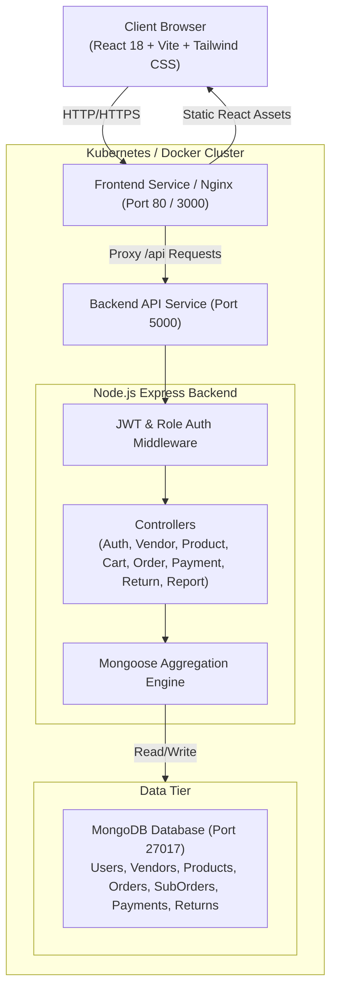
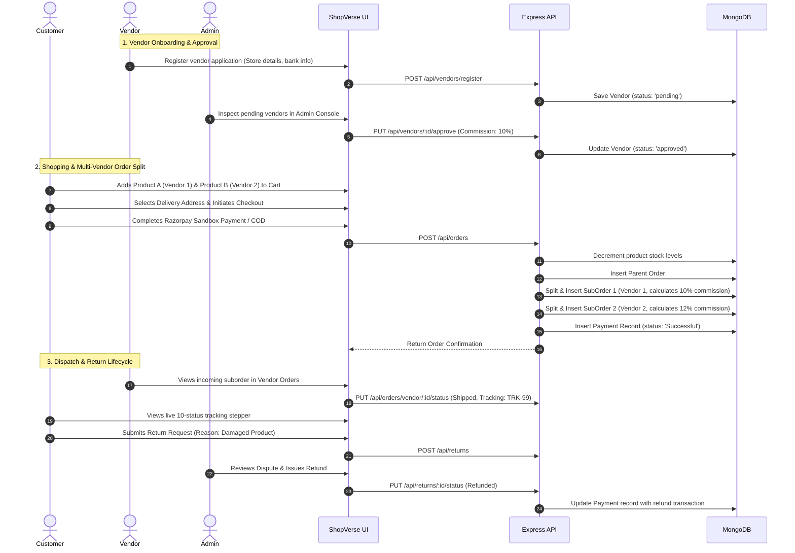
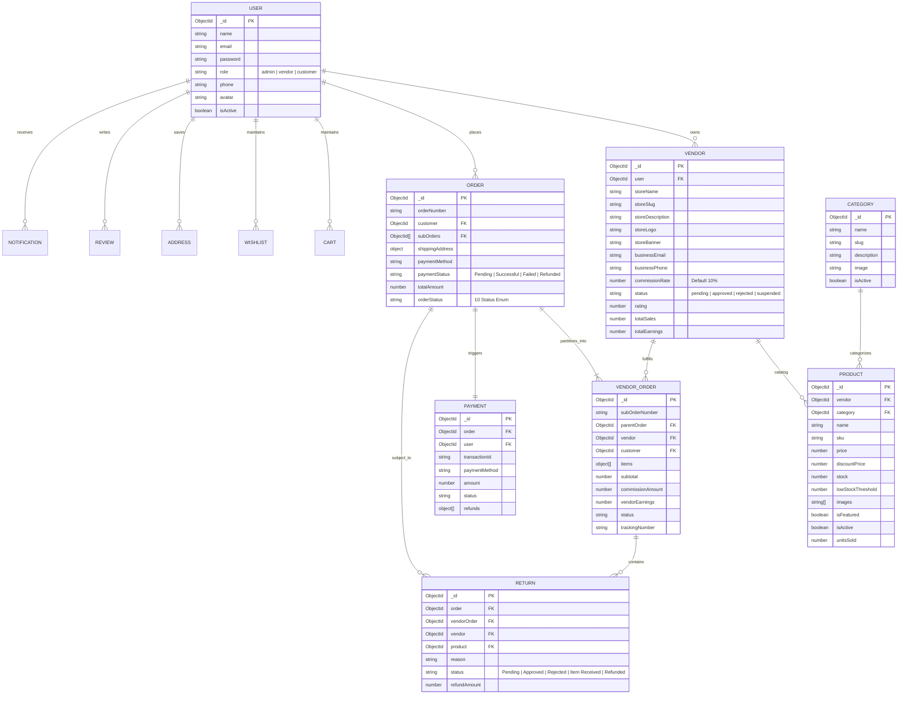

# ShopVerse — Multi-Vendor E-Commerce Shopping Platform

A comprehensive, responsive, full-stack Multi-Vendor E-Commerce Shopping Platform engineered with **React.js, Node.js, Express.js, MongoDB, Tailwind CSS, Docker, and Kubernetes**.

ShopVerse supports three distinct user roles (**Administrator, Vendor, Customer**) featuring isolated multi-vendor suborder processing, real-time order tracking with a 10-state lifecycle, automated platform commission calculations, sandbox payment verification (Razorpay test mode and Cash on Delivery), and five mandatory executive business reports with CSV and PDF export capabilities.

---

## Table of Contents
1. [Project Abstract](#1-project-abstract)
2. [Problem Statement](#2-problem-statement)
3. [Project Objectives](#3-project-objectives)
4. [Scope of the Project](#4-scope-of-the-project)
5. [Functional Requirements](#5-functional-requirements)
6. [Non-Functional Requirements](#6-non-functional-requirements)
7. [Technology Stack](#7-technology-stack)
8. [System Architecture Diagram](#8-system-architecture-diagram)
9. [Application Workflow Diagram](#9-application-workflow-diagram)
10. [Database Design & ER Diagram](#10-database-design--er-diagram)
11. [Database Schema Descriptions](#11-database-schema-descriptions)
12. [Backend REST API Documentation](#12-backend-rest-api-documentation)
13. [User Role Descriptions & Permissions](#13-user-role-descriptions--permissions)
14. [Functional Screens Implemented](#14-functional-screens-implemented)
15. [Mandatory Business Reports](#15-mandatory-business-reports)
16. [Multi-Vendor Order Processing Mechanism](#16-multi-vendor-order-processing-mechanism)
17. [Payment Sandbox & Refund Workflow](#17-payment-sandbox--refund-workflow)
18. [Frontend Setup & Installation](#18-frontend-setup--installation)
19. [Backend Setup & Installation](#19-backend-setup--installation)
20. [Environment Variables](#20-environment-variables)
21. [Docker Containerization](#21-docker-containerization)
22. [Kubernetes Cluster Deployment](#22-kubernetes-cluster-deployment)
23. [Testing Procedures & Verification](#23-testing-procedures--verification)
24. [Security Features](#24-security-features)
25. [Limitations & Future Enhancements](#25-limitations--future-enhancements)

---

## 1. Project Abstract
Modern e-commerce requires decentralized seller storefronts, consolidated customer carts, and automated multi-party financial reconciliation. **ShopVerse** solves this by orchestrating independent vendors under a unified marketplace. Customers can place a single checkout order containing products from multiple distinct sellers. The backend transparently splits this into individual vendor suborders, computes platform commissions and vendor earnings, updates real-time inventory, tracks package dispatches across 10 granular statuses, handles return disputes, and delivers five executive business reports complete with interactive Recharts visualizations, CSV spreadsheets, and downloadable PDF documents.

---

## 2. Problem Statement
Traditional monolithic shopping platforms restrict selling to a single entity, forcing vendors to build individual web presences with high customer acquisition overhead. Conversely, basic marketplace implementations often suffer from:
- Inability to partition a single customer order across multiple vendors.
- Lack of role-based data isolation (vendors seeing competitors' proprietary sales data).
- Static or mock dashboards lacking actual database aggregation.
- Inadequate tracking for returns, replacements, and sandbox refunds.
- Cumbersome deployment mechanisms that fail in containerized cloud environments.

ShopVerse addresses these challenges by implementing full-stack role-based access control, robust Mongoose document schemas, automated vendor order partitioning, interactive payment sandboxing, and production-grade Docker and Kubernetes orchestration.

---

## 3. Project Objectives
- Engineer a 3-tier multi-role platform (**Admin, Vendor, Customer**) using React 18, Vite, Node.js, and MongoDB.
- Deliver at least 15 functional, connected frontend screens adhering to an executive Navy Blue and Orange accent design system.
- Build an automated order splitting algorithm that divides a parent order into vendor-specific suborders (`VendorOrder`) with per-vendor commission and earnings calculations.
- Implement an end-to-end 10-status order fulfillment lifecycle (**Pending → Confirmed → Processing → Shipped → Delivered → Cancelled → Return Requested → Returned → Refund Processing → Refunded**).
- Deliver 5 mandatory business reports powered by real MongoDB aggregation pipelines with date filtering, CSV export, and PDF generation.
- Provide comprehensive Docker containerization (`docker-compose.yml`) and declarative Kubernetes deployment manifests (`kubernetes/`).

---

## 4. Scope of the Project
- **Customer Realm**: Authentication, catalog search, category/price filters, wishlist, multi-vendor cart, address management, sandbox checkout, order tracking stepper, review submission, return claims.
- **Vendor Realm**: Onboarding application, storefront branding, catalog inventory management, pricing/discounts, incoming suborder dispatch, return request reviews, sales analytics.
- **Admin Realm**: Marketplace oversight, vendor approval/rejection/suspension, user account moderation, global catalog controls, platform commission tuning, 5 executive analytics reports.
- **Deployment Realm**: Local development with automated in-memory MongoDB fallback, multi-container Docker Compose, and Kubernetes deployment with Pod replicas, Services, ConfigMaps, and Secrets.

---

## 5. Functional Requirements
1. **Authentication & Authorization**: JWT token exchange, Bcrypt password hashing, and role-based route middleware.
2. **Storefront Management**: Vendors can configure store name, bio, logo, banner, contact info, and payout banking details.
3. **Multi-Vendor Cart & Checkout**: Single cart accepting products across multiple vendors; consolidated checkout with real-time stock verification.
4. **Order Splitting**: Backend splits parent order into isolated `VendorOrder` records accessible only by the respective seller.
5. **Inventory Deductions & Rollbacks**: Stock automatically decrements upon checkout and rolls back if an eligible order is cancelled.
6. **Payment Sandbox**: Interactive Razorpay test mode modal (Card, UPI, Netbanking simulation) plus Cash on Delivery support.
7. **Dispute Resolution & Returns**: Customers submit return claims with categorized reasons; vendors and admins resolve disputes and disburse refunds.
8. **Reporting Engine**: Five MongoDB aggregation reports exportable to CSV and auto-table PDF.

---

## 6. Non-Functional Requirements
- **Performance**: Sub-100ms API response times via MongoDB indexing on foreign keys and search terms.
- **Security**: JWT stored securely, passwords hashed with salt rounds, no sensitive credit card data persisted.
- **Modularity**: Strict separation between controllers, models, middleware, and route handlers.
- **Scalability**: Stateless backend API ready for horizontal scaling behind Kubernetes LoadBalancer/NodePort services.
- **Reliability**: Graceful fallback to `MongoMemoryServer` when external MongoDB daemons or network URIs are unavailable.

---

## 7. Technology Stack

### Frontend
- **Framework**: React.js 18 with Vite
- **Styling**: Tailwind CSS, PostCSS, Autoprefixer
- **Routing**: React Router DOM v6
- **State Management**: React Context API (`AuthContext`, `CartContext`, `WishlistContext`)
- **HTTP Client**: Axios with request/response interceptors
- **Data Visualization**: Recharts (AreaChart, BarChart, LineChart)
- **Icons**: Lucide React
- **Notifications**: React Hot Toast
- **Reporting & Export**: jsPDF, jspdf-autotable, HTML5 Print API

### Backend
- **Runtime**: Node.js v20+
- **Framework**: Express.js REST API
- **Database ODM**: Mongoose v8
- **Authentication**: JSON Web Tokens (`jsonwebtoken`), `bcryptjs`
- **Database Engine**: MongoDB Atlas / local MongoDB / containerized MongoDB / `mongodb-memory-server`
- **Payment Sandbox**: Razorpay SDK & Interactive Sandbox Simulator
- **Logging**: Morgan HTTP logger

### DevOps & Orchestration
- **Containerization**: Docker (Multi-stage build for React with Nginx; Node Alpine for backend)
- **Compose**: Docker Compose v2 with persistent MongoDB volume
- **Kubernetes**: Deployments, Services (ClusterIP & NodePort), ConfigMaps, Secrets

---

## 8. System Architecture Diagram



---

## 9. Application Workflow Diagram



---

## 10. Database Design & ER Diagram



---

## 11. Database Schema Descriptions

The application defines **14 Mongoose collections** with strict schema validation, indexes, and automated hooks:

1. **Users (`User.js`)**: Handles authentication, Bcrypt salt hashing, profile attributes, and role designations (`admin`, `vendor`, `customer`).
2. **Vendors (`Vendor.js`)**: Stores merchant details, commission rates (default 10%), approval status (`pending`, `approved`, `rejected`, `suspended`), total sales, and banking payout records.
3. **Categories (`Category.js`)**: Global catalog categories with automated slug generation, image assets, and active toggles.
4. **Products (`Product.js`)**: Products tied to vendors and categories with pricing, discount calculations, inventory counters, low-stock thresholds, tags, and average customer ratings.
5. **Carts (`Cart.js`)**: Active shopping carts with real-time stock verification and quantity validation.
6. **Wishlists (`Wishlist.js`)**: Saved customer product collections for future purchase.
7. **Orders (`Order.js`)**: Parent customer order records with consolidated item totals, shipping address snapshots, payment status, and a 10-status order history timeline.
8. **VendorOrders (`VendorOrder.js`)**: Partitioned suborders belonging to individual vendors with computed `subtotal`, `commissionAmount`, `vendorEarnings`, and carrier tracking numbers.
9. **Payments (`Payment.js`)**: Financial ledger records storing transaction IDs, payment gateway metadata, and an array of refund disbursements.
10. **Reviews (`Review.js`)**: Verified customer ratings (1–5 stars) and comments with static Mongoose aggregation calculating the product's running average rating.
11. **Coupons (`Coupon.js`)**: Discount coupons (e.g. `WELCOME10`) supporting percentage discounts, expiry dates, and usage limits.
12. **Addresses (`Address.js`)**: Multiple saved delivery addresses per customer with an automatic `pre('save')` hook managing default address toggles.
13. **Returns (`Return.js`)**: Return claim requests referencing specific suborder items, categorized return reasons, vendor comments, and refund transaction references.
14. **Notifications (`Notification.js`)**: In-app notifications for order updates, vendor approvals, stock alerts, and return claims.

---

## 12. Backend REST API Documentation

### Authentication & Profile (`/api/auth`)
| Method | Endpoint | Access | Description |
|---|---|---|---|
| `POST` | `/api/auth/register` | Public | Register customer or vendor account |
| `POST` | `/api/auth/login` | Public | Authenticate user & return JWT token |
| `GET` | `/api/auth/me` | Private | Retrieve authenticated user profile |
| `PUT` | `/api/auth/profile` | Private | Update user personal details and password |

### Vendors (`/api/vendors`)
| Method | Endpoint | Access | Description |
|---|---|---|---|
| `POST` | `/api/vendors/register` | Private | Submit vendor storefront application |
| `GET` | `/api/vendors` | Public | Get list of approved vendors (Admin gets all) |
| `GET` | `/api/vendors/:id` | Public | Get public storefront details & products |
| `GET` | `/api/vendors/me/profile` | Vendor | Retrieve logged-in vendor store profile |
| `PUT` | `/api/vendors/me/profile` | Vendor | Update storefront branding and banking info |
| `PUT` | `/api/vendors/:id/approve` | Admin | Approve pending vendor & set commission % |
| `PUT` | `/api/vendors/:id/reject` | Admin | Reject vendor application with reason |
| `PUT` | `/api/vendors/:id/toggle-status` | Admin | Suspend or reactivate vendor store |

### Products (`/api/products`)
| Method | Endpoint | Access | Description |
|---|---|---|---|
| `GET` | `/api/products` | Public | Query catalog (search, filter, sort, paginate) |
| `GET` | `/api/products/featured` | Public | Retrieve curated homepage products |
| `GET` | `/api/products/:id` | Public | Get product details with reviews |
| `GET` | `/api/products/vendor/my-products` | Vendor | List vendor's own products |
| `POST` | `/api/products` | Vendor | Create new product listing |
| `PUT` | `/api/products/:id` | Vendor/Admin | Update product specifications and stock |
| `DELETE` | `/api/products/:id` | Vendor/Admin | Remove product from marketplace |

### Shopping Cart (`/api/cart`)
| Method | Endpoint | Access | Description |
|---|---|---|---|
| `GET` | `/api/cart` | Private | Retrieve populated cart with item totals |
| `POST` | `/api/cart` | Private | Add item to cart with stock validation |
| `PUT` | `/api/cart/:productId` | Private | Update item quantity in cart |
| `DELETE` | `/api/cart/:productId` | Private | Remove item from cart |
| `DELETE` | `/api/cart` | Private | Clear all items from cart |

### Multi-Vendor Orders (`/api/orders`)
| Method | Endpoint | Access | Description |
|---|---|---|---|
| `POST` | `/api/orders` | Customer | Place multi-vendor order (splits suborders) |
| `GET` | `/api/orders/my-orders` | Customer | Retrieve customer's purchase history |
| `GET` | `/api/orders/:id` | Private | Get full order details with suborders |
| `PUT` | `/api/orders/:id/cancel` | Customer/Admin | Cancel order & roll back inventory |
| `GET` | `/api/orders/vendor/all` | Vendor | Retrieve vendor-assigned suborders |
| `PUT` | `/api/orders/vendor/:id/status` | Vendor/Admin | Update suborder status & tracking carrier |
| `GET` | `/api/orders/admin/all` | Admin | Monitor all platform parent orders |

### Payments & Sandbox (`/api/payments`)
| Method | Endpoint | Access | Description |
|---|---|---|---|
| `POST` | `/api/payments/create-order` | Private | Initialize Razorpay sandbox order |
| `POST` | `/api/payments/verify` | Private | Verify payment signature or sandbox result |
| `GET` | `/api/payments/my-payments` | Customer | View customer payment transactions |
| `GET` | `/api/payments/admin/all` | Admin | Audit all platform transactions and refunds |

### Returns & Disputes (`/api/returns`)
| Method | Endpoint | Access | Description |
|---|---|---|---|
| `POST` | `/api/returns` | Customer | Submit return request with reason |
| `GET` | `/api/returns/my-returns` | Customer | View customer's return requests |
| `GET` | `/api/returns/vendor/all` | Vendor | View return claims on vendor's products |
| `PUT` | `/api/returns/:id/status` | Vendor/Admin | Update return status (Approved/Refunded) |
| `GET` | `/api/returns/admin/all` | Admin | Oversee all disputes and resolutions |

### Mandatory Reports (`/api/reports`)
| Method | Endpoint | Access | Description |
|---|---|---|---|
| `GET` | `/api/reports/sales` | Admin/Vendor | **Report 1: Sales Report** |
| `GET` | `/api/reports/vendor-sales` | Admin/Vendor | **Report 2: Vendor-Wise Sales Report** |
| `GET` | `/api/reports/orders` | Admin/Vendor | **Report 3: Order Report** |
| `GET` | `/api/reports/inventory` | Admin/Vendor | **Report 4: Inventory Report** |
| `GET` | `/api/reports/payments` | Admin | **Report 5: Payment & Refund Report** |

---

## 13. User Role Descriptions & Permissions

| Feature | Administrator | Vendor | Customer |
|---|:---:|:---:|:---:|
| Browse & Search Catalog | ✅ | ✅ | ✅ |
| Shopping Cart & Wishlist | ✅ | ✅ | ✅ |
| Multi-Vendor Checkout | ✅ | ✅ | ✅ |
| Cancel Eligible Orders | ✅ | ❌ | ✅ |
| Request Product Returns | ❌ | ❌ | ✅ |
| Submit Product Reviews | ❌ | ❌ | ✅ |
| Storefront Registration | ❌ | ✅ | ❌ |
| Manage Own Store & Products | ❌ | ✅ | ❌ |
| Update Suborder Fulfillment | ✅ | ✅ (Own Only) | ❌ |
| Resolve Return Requests | ✅ | ✅ (Own Only) | ❌ |
| View Vendor-Specific Sales Report | ✅ (All) | ✅ (Own Only) | ❌ |
| Approve / Reject Vendors | ✅ | ❌ | ❌ |
| Suspend / Activate Vendors | ✅ | ❌ | ❌ |
| Manage Platform Commission | ✅ | ❌ | ❌ |
| View All 5 Platform Reports | ✅ | ❌ | ❌ |
| Export Reports to CSV & PDF | ✅ | ✅ (Own) | ❌ |

---

## 14. Functional Screens Implemented

1. **Login & Registration Screen (`/login`, `/register`)**: Role-based authentication with quick-fill demo buttons for Admin, Vendor, and Customer.
2. **Vendor Registration Screen (`/vendor/register`)**: Merchant application collecting store name, bio, dispatch address, and payout banking details.
3. **Customer Home Screen (`/`)**: Hero banner, category carousels, featured products grid, promotional coupon announcement (`WELCOME10`), and featured vendor cards.
4. **Product Catalog Listing (`/products`)**: Product grid with keyword search, category filter sidebar, price range sliders, star rating filter, in-stock toggle, sorting dropdown, and pagination.
5. **Product Details Screen (`/products/:id`)**: High-res image gallery with thumbnails, real-time pricing and discount badges, stock availability with low-stock alerts, Add to Cart / Buy Now actions, vendor info card, and customer review submission.
6. **Public Storefront Screen (`/stores/:id`)**: Vendor profile banner, logo, seller rating, contact details, and catalog of products sold by that specific merchant.
7. **Shopping Cart Screen (`/cart`)**: Products grouped by fulfilling vendor, quantity controls, price breakdown, and free shipping threshold calculation.
8. **Checkout & Payment Screen (`/checkout`)**: Multi-address manager, item summary grouped by vendor, coupon code applicator, Cash on Delivery option, and interactive Razorpay test mode modal.
9. **Customer Orders Screen (`/orders`)**: Complete order history cards with suborder counts, total amount, order status badges, and quick links.
10. **Order Tracking Screen (`/orders/:id`)**: Interactive visual 10-status order tracking stepper, vendor suborders breakdown with carrier tracking numbers, order cancellation, and return claim trigger.
11. **Customer Profile & Address Management (`/profile`)**: Personal profile editor, multi-address manager (Add, Edit, Delete, Set Default), and return claims tracker.
12. **Wishlist Screen (`/wishlist`)**: Saved customer items with instant move-to-cart and removal.
13. **Vendor Dashboard Screen (`/vendor/dashboard`)**: KPI metric cards (Gross Sales, Net Earnings, Orders Count, Low-Stock Warnings), Recharts monthly sales area chart, daily sales bar chart, and recent incoming orders.
14. **Vendor Product Management Screen (`/vendor/products`, `/vendor/products/new`, `/vendor/products/:id/edit`)**: Vendor catalog table with stock status pills, active/inactive toggles, add product form with multi-image URL inputs, and edit modal.
15. **Vendor Order Management Screen (`/vendor/orders`)**: Incoming suborders table, filter by fulfillment status, update status modal with shipping carrier and tracking number inputs.
16. **Vendor Returns Screen (`/vendor/returns`)**: Customer return claims table, customer explanation review, and resolution status updater.
17. **Vendor Reports Screen (`/vendor/reports`)**: Store-specific sales performance with date range filter, Recharts growth area chart, product sales table, and CSV/PDF/Print export buttons.
18. **Admin Dashboard Screen (`/admin/dashboard`)**: Platform-wide KPI cards (Customers, Total Vendors, Pending Vendors, Products, Orders, GMV, Revenue), Recharts monthly revenue chart, top vendor leaderboard, and recent orders.
19. **Admin Vendor Management Screen (`/admin/vendors`)**: Vendor onboarding pipeline table, commission rate approval modal, rejection modal with required reason, and suspend/reactivate toggles.
20. **Admin Product Management Screen (`/admin/products`)**: Marketplace product listings oversight, category filtering, and compliance moderation.
21. **Admin Category Management Screen (`/admin/categories`)**: Category cards grid with Add/Edit/Delete modals, automated slug generation, and banner management.
22. **Admin All Orders Screen (`/admin/orders`)**: Platform-wide parent orders table with vendor participation details and fulfillment status inspection.
23. **Admin Returns & Dispute Screen (`/admin/returns`)**: Platform dispute resolution console with refund issuance capabilities.
24. **Admin Reports & Analytics Screen (`/admin/reports`)**: Five-tab dashboard implementing all mandatory reports with live charts, universal date picker, and CSV, PDF, and Print export options.

---

## 15. Mandatory Business Reports

All five reports run against live MongoDB records via Mongoose aggregation pipelines:

### REPORT 1: SALES REPORT
- **Aggregated Metrics**: Gross Sales (GMV), Total Orders, Platform Take-Rate Revenue, Net Vendor Payouts, Items Subtotal, Shipping Collected, Discounts Applied.
- **Charts**: Recharts AreaChart showing monthly revenue trends.
- **Product-Wise Breakdown**: Units sold, unit price, stock balance, and gross product revenue.
- **Exports**: Downloadable CSV, formatted PDF with AutoTable, and clean browser print view.

### REPORT 2: VENDOR-WISE SALES REPORT
- **Aggregated Metrics**: Store Name, Vendor Owner, Total Orders Fulfilled, Products Sold, Gross Sales, Platform Commission Deducted, Net Vendor Earnings.
- **Charts**: Recharts BarChart providing visual comparison across merchants.
- **Role Isolation**: Admin inspects all vendors; vendors only see their own store data.
- **Exports**: CSV, PDF, Print.

### REPORT 3: ORDER REPORT
- **Aggregated Metrics**: Order ID, Customer Name, Email, Destination City, Order Date, Product Names & Quantities, Participating Vendors, Order Amount, Payment Method, Order Status, Delivery Status.
- **Filtering**: Date range picker (start and end date), status selector, search bar.
- **Exports**: CSV, PDF, Print.

### REPORT 4: INVENTORY REPORT
- **Aggregated Metrics**: Product Name, SKU, Fulfilling Vendor, Category, Unit Price, Available Stock Units, Units Sold, Total Inventory Valuation (`Price × Available Stock`), Stock Alert Status.
- **Stock Alert Thresholds**:
  - `Out of Stock`: Available Stock = 0 (Rose badge)
  - `Low Stock Alert`: Available Stock ≤ Low-Stock Threshold (Amber badge)
  - `In Stock`: Available Stock > Threshold (Emerald badge)
  - **Exports**: CSV, PDF, Print.

### REPORT 5: PAYMENT REPORT
- **Aggregated Metrics**: Transaction ID, Order Number, Customer Name, Payment Method (Razorpay / COD), Transaction Amount, Payment Date, Payment Status (`Pending`, `Successful`, `Failed`, `Refunded`, `Partially Refunded`), and Refund Status.
- **Summary Cards**: Total Transactions, Gross Amount Processed, Successful Settlements, Total Refunds Issued.
- **Exports**: CSV, PDF, Print.

---

## 16. Multi-Vendor Order Processing Mechanism

When a customer checks out a cart containing items from multiple distinct vendors:
1. **Inventory Deduction**: Backend verifies stock for all items; decrements `Product.stock` and increments `Product.unitsSold`.
2. **Parent Order Creation**: A master `Order` record is generated with a unique order number (`ORD-YYYYMM-XXXX`), consolidated items, shipping address, and total amount.
3. **Partitioning Suborders**: The order items are grouped by `vendorId`. For each distinct vendor:
   - A `VendorOrder` suborder is created (`ORD-YYYYMM-XXXX-V1`, `ORD-YYYYMM-XXXX-V2`).
   - `subtotal = Sum(item.price × item.quantity)`
   - `commissionAmount = Math.round((subtotal × vendor.commissionRate) / 100)`
   - `vendorEarnings = subtotal - commissionAmount`
   - Vendor sales counters (`totalSales`, `totalOrders`, `totalEarnings`) are updated.
4. **Parent Order Linking**: The created `VendorOrder` IDs are stored in the parent order's `subOrders` array.
5. **Decoupled Fulfillment**: Each vendor independently accepts, packs, adds tracking numbers, and updates the status of their own suborder.
6. **Parent Status Synchronization**: When all suborders reach `Delivered`, the parent order transitions to `Delivered`.

---

## 17. Payment Sandbox & Refund Workflow

### Razorpay Sandbox Integration
- Integrates Razorpay test mode SDK.
- If live test keys are configured (`RAZORPAY_KEY_ID`, `RAZORPAY_KEY_SECRET`), the backend generates a signed Razorpay order.
- If keys are omitted in offline evaluation, the application provides an interactive **Razorpay Sandbox Simulation Modal**:
  - Preloaded test credit cards (`4111 2222 3333 4444`, `12/28`, `123`).
  - Preloaded UPI VPAs (`testuser@okhdfcbank`).
  - Netbanking bank selector.
  - Interactive "Simulate Successful Payment" and "Simulate Declined Payment" triggers for testing error handling.

### Refund Processing Workflow
- When an eligible order is cancelled before dispatch, the payment status automatically transitions to `Refunded`.
- When a customer requests a return for a delivered item:
  - Return claim is logged in `Return` collection with reason and photos.
  - Vendor or Admin reviews and approves the claim.
  - Upon item inspection, status moves to `Refunded`.
  - Backend issues a refund ID (`REF-XXXXXXXXXX`), records the refund in `Payment.refunds`, and adjusts suborder and parent order totals.

---

## 18. Frontend Setup & Installation

### Prerequisites
- Node.js v18+ and npm installed

### Step-by-Step Setup
```bash
# Navigate to frontend folder
cd frontend

# Install dependencies
npm install

# Start Vite development server
npm run dev
```

The frontend will start at **`http://localhost:3000`** with automated API proxying to `http://localhost:5000`.

To create an optimized production build:
```bash
npm run build
```

---

## 19. Backend Setup & Installation

### Prerequisites
- Node.js v18+ and npm installed
- MongoDB installed locally or MongoDB Atlas connection string (Optional: if no MongoDB is installed, the backend will automatically spin up an in-memory MongoDB server instance!)

### Step-by-Step Setup
```bash
# Navigate to backend folder
cd backend

# Install dependencies
npm install

# Seed the database with sample vendors, categories, products, and orders
npm run seed

# Start Express development server
npm run dev
```

The backend server will start at **`http://localhost:5000`**.

### Default Demo User Credentials
| Role | Email | Password |
|---|---|---|
| **Administrator** | `admin@shopverse.com` | `adminpassword123` |
| **Vendor 1 (Approved)** | `vendor1@techpulse.com` | `vendorpassword123` |
| **Vendor 2 (Approved)** | `vendor2@stylehub.com` | `vendorpassword123` |
| **Vendor 3 (Pending)** | `vendor3@greenroots.com` | `vendorpassword123` |
| **Customer 1** | `customer1@gmail.com` | `customerpassword123` |
| **Customer 2** | `customer2@gmail.com` | `customerpassword123` |

*(Note: The login page includes 1-click preset buttons for Admin, Vendor, and Customer for instantaneous evaluation!)*

---

## 20. Environment Variables

### Backend (`backend/.env`)
```env
PORT=5000
NODE_ENV=development
MONGODB_URI=mongodb://localhost:27017/multivendor
JWT_SECRET=super_secret_multivendor_jwt_key_2026
RAZORPAY_KEY_ID=rzp_test_sandbox_2026
RAZORPAY_KEY_SECRET=rzp_test_secret_sandbox_2026
CLIENT_URL=http://localhost:3000
```

### Frontend (`frontend/.env`)
```env
VITE_API_BASE_URL=/api
VITE_RAZORPAY_KEY_ID=rzp_test_sandbox_2026
```

---

## 21. Docker Containerization

The project includes production-ready Dockerfiles for both services and a unified multi-container Docker Compose configuration.

### Directory Artifacts
- `backend/Dockerfile` (Node 20 Alpine production image)
- `frontend/Dockerfile` (Multi-stage build compiling React with Vite and serving static assets via Nginx)
- `frontend/nginx.conf` (Nginx configuration with `/api` reverse proxying and HTML5 client routing)
- `docker-compose.yml` (Orchestrates `mongo`, `backend`, and `frontend`)

### Running with Docker Compose
```bash
# Build the Docker images
docker compose build

# Start all three containers in detached mode
docker compose up -d

# Verify container status
docker compose ps

# Inspect container logs
docker compose logs -f
```

### Accessing the Running Containers
- **Frontend Web Application**: `http://localhost:3000`
- **Backend Health Check**: `http://localhost:5000/api/health`
- **MongoDB Database**: `mongodb://localhost:27017`

---

## 22. Kubernetes Cluster Deployment

The `kubernetes/` folder contains production-ready YAML manifests designed for deployment on Minikube, Kind, or managed cloud Kubernetes clusters (EKS/GKE/AKS).

### Kubernetes Manifests Provided
- `kubernetes/configmap.yaml`: Non-sensitive application configuration (`NODE_ENV`, `PORT`, `MONGODB_URI`).
- `kubernetes/secret.yaml`: Sensitive credentials (`JWT_SECRET`, Razorpay keys).
- `kubernetes/mongo-deployment.yaml`: Pod deployment running containerized MongoDB 6.0 with volume storage.
- `kubernetes/mongo-service.yaml`: ClusterIP service exposing MongoDB internally on port 27017.
- `kubernetes/backend-deployment.yaml`: Replicated Pod deployment (2 replicas) with liveness & readiness health probes to `/api/health`.
- `kubernetes/backend-service.yaml`: ClusterIP service routing traffic to the Node.js backend on port 5000.
- `kubernetes/frontend-deployment.yaml`: Replicated Pod deployment (2 replicas) serving the React UI.
- `kubernetes/frontend-service.yaml`: NodePort service exposing the frontend on port 30080.

### Deployment Instructions (Minikube / Cluster)
```bash
# Apply all manifests to the cluster
kubectl apply -f kubernetes/

# Verify deployments
kubectl get deployments

# Verify running pods
kubectl get pods

# Verify services
kubectl get services

# Inspect pod details if needed
kubectl describe pods -l app=backend
```

---

## 23. Testing Procedures & Verification

### Automated Integration Test Suite
The repository includes an automated integration test script (`backend/tests/api.test.js`) validating all core user stories and reporting pipelines:

```bash
cd backend
npm test
```

### Verified Test Results (20 / 20 Tests Passed):
```
====================================================
🧪 Starting Multi-Vendor Platform Backend Test Suite
====================================================

--- Test Group 1: Health & Public Endpoints ---
  ✅ PASS: GET /api/health returns status 200 and ok
  ✅ PASS: GET /api/categories returns categories list
  ✅ PASS: GET /api/products returns products list
  ✅ PASS: GET /api/vendors returns approved vendors list

--- Test Group 2: Authentication & RBAC ---
  ✅ PASS: Admin login succeeds with JWT and role=admin
  ✅ PASS: Vendor login succeeds with JWT and vendor profile
  ✅ PASS: Customer login succeeds with JWT and role=customer
  ✅ PASS: Customer cannot access Admin Dashboard (HTTP 403 Forbidden)

--- Test Group 3: Cart & Multi-Vendor Order Processing ---
  ✅ PASS: Customer can add product 1 to cart
  ✅ PASS: Customer can add product 2 to cart
  ✅ PASS: Multi-vendor order created with parent order & suborders

--- Test Group 4: Vendor Suborder Management ---
  ✅ PASS: Vendor can retrieve their assigned suborders only
  ✅ PASS: Vendor can update suborder status to Shipped

--- Test Group 5: Payment Sandbox Verification ---
  ✅ PASS: Create Razorpay sandbox payment order returns order id
  ✅ PASS: Payment signature verification succeeds

--- Test Group 6: All 5 Mandatory Reports Verification ---
  ✅ PASS: Report 1: GET /api/reports/sales returns totalSales, orders & trends
  ✅ PASS: Report 2: GET /api/reports/vendor-sales returns vendor breakdown
  ✅ PASS: Report 3: GET /api/reports/orders returns detailed orders data
  ✅ PASS: Report 4: GET /api/reports/inventory returns valuation & low-stock alerts
  ✅ PASS: Report 5: GET /api/reports/payments returns transaction & refund stats

====================================================
📊 Test Results: 20 PASSED | 0 FAILED
====================================================
```

---

## 24. Security Features
- **Stateless JWT Authorization**: Bearer token authentication verified on every protected API call.
- **Bcrypt Password Hashing**: Passwords stored with salt hashing; never exposed in plain text.
- **Strict Role-Based Access Control**: Middleware (`authorize('admin', 'vendor')`) enforces role checks at the route boundary.
- **Vendor Data Isolation**: Queries for vendor orders, inventory, and reports strictly filter by `req.vendor._id` to prevent multi-tenant data leakage.
- **Input Sanitization & Validation**: Mongoose schema validations prevent invalid prices, negative stock, or orphaned references.
- **Centralized Error Handling**: Prevents sensitive database stack traces from leaking to client responses in production.

---

## 25. Limitations & Future Enhancements

### Limitations
- File uploads are implemented via direct image URLs and CDN links; direct S3 bucket streaming is optional.
- Payments operate in sandbox / test mode without debiting live currency.

### Future Enhancements
- Webhook integration for real-time third-party logistics courier updates (Shiprocket / Delhivery APIs).
- Automated scheduled vendor bank payout disbursements via RazorpayX Route APIs.
- AI-driven product recommendation engine and multi-lingual storefront support.
- Progressive Web App (PWA) offline cart synchronization.

---

## License
Developed for educational, research, and demonstration purposes. All rights reserved.
